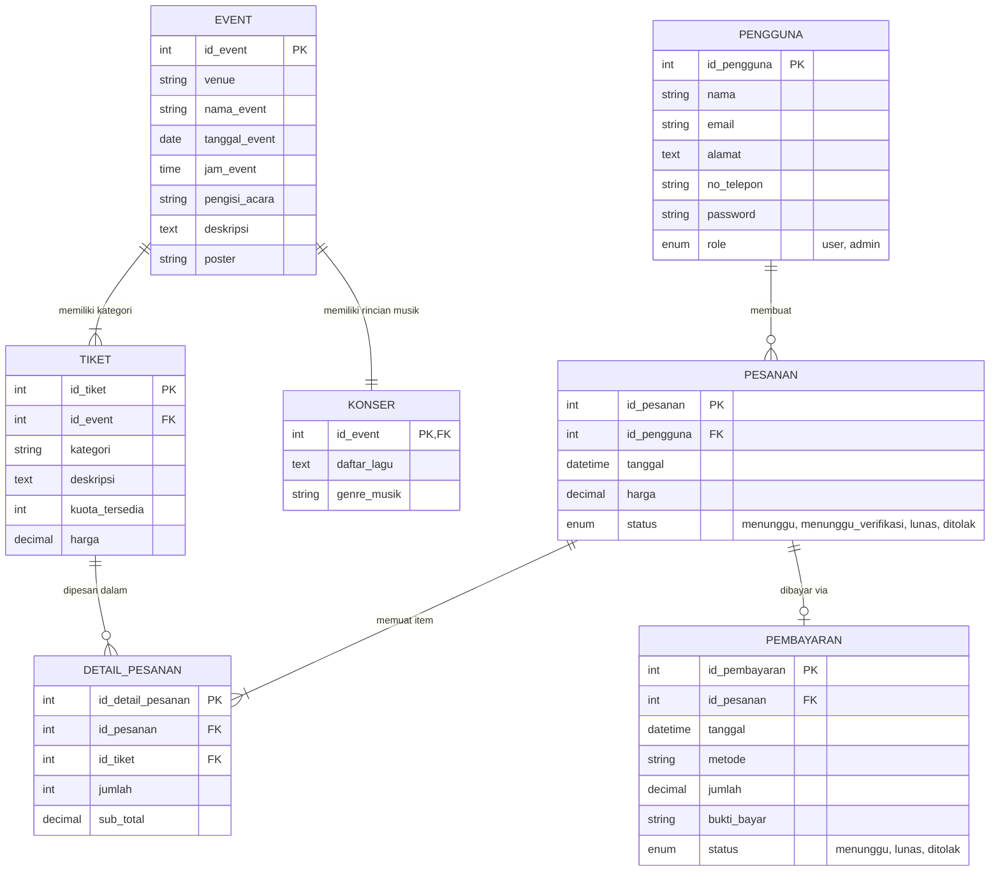
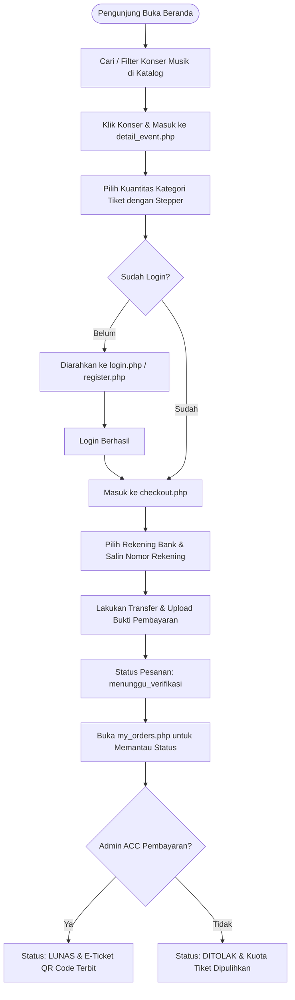
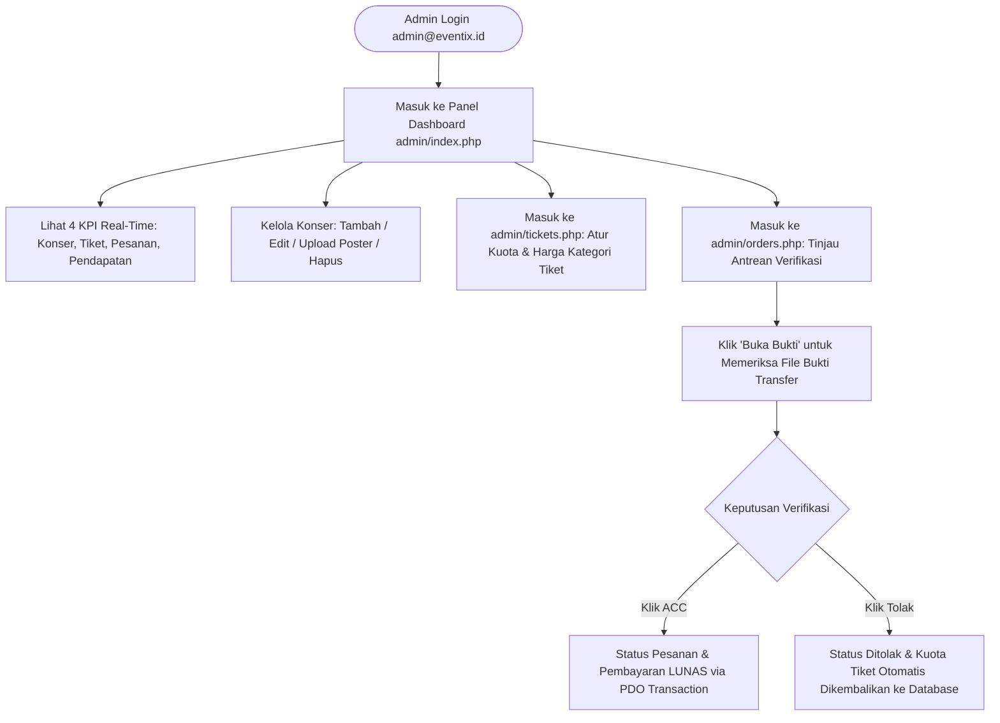

# DOKUMENTASI LENGKAP SISTEM INFORMASI EVENTIX
## Sistem Informasi Manajemen & Pemesanan Tiket Konser Musik (Full-Stack PHP Native Terstruktur)

---

## DAFTAR ISI
1. [Tentang Sistem EVENTIX](#1-tentang-sistem-eventix)
2. [Panduan Instalasi & Menjalankan di XAMPP / Laragon](#2-panduan-instalasi--menjalankan-di-xampp--laragon)
3. [Daftar Akun Login Demo (Pengujian)](#3-daftar-akun-login-demo-pengujian)
4. [Struktur Folder & Penjelasan Fungsi Berkas](#4-struktur-folder--penjelasan-fungsi-berkas)
5. [Skema Database & Relasi Tabel (Entity Relationship)](#5-skema-database--relasi-tabel-entity-relationship)
6. [Alur Bisnis Sistem (User & Admin Journey)](#6-alur-bisnis-sistem-user--admin-journey)
7. [Bedah Kodingan Inti & Konsep Teknis (Bahan Presentasi / Sidang)](#7-bedah-kodingan-inti--konsep-teknis-bahan-presentasi--sidang)
8. [Lampiran Source Code Inti Terpilih](#8-lampiran-source-code-inti-terpilih)

---

## 1. TENTANG SISTEM EVENTIX

**EVENTIX** adalah aplikasi web full-stack terstruktur yang dibangun khusus untuk manajemen konser musik dan pemesanan tiket resmi (*e-ticketing*) berskala nasional. 

Aplikasi ini dirancang dengan standar arsitektur profesional berbasis **Clean PHP 8+ Native (Terstruktur)**, **MySQL/MariaDB dengan PDO (PHP Data Objects)**, antarmuka modern terinspirasi desain Loket.com berbasis **Tailwind CSS**, serta interaktivitas real-time menggunakan **Vanilla JavaScript (Fetch API / AJAX)** tanpa ketergantungan framework berat (seperti Laravel, React, Node.js, atau Next.js).

### Fitur Unggulan Sistem:
1. **Katalog & Live Search Real-Time**: Pencarian instan dan filter genre musik/tanggal tanpa reload halaman (*asynchronous*).
2. **Detail Konser & Setlist Eksklusif**: Menampilkan prediksi daftar lagu (*setlist*) konser, venue stadion, pengisi acara, dan syarat masuk.
3. **Pemesanan Multi-Kategori & Stepper Interaktif**: Kalkulasi otomatis subtotal dan grand total biaya secara langsung di peramban.
4. **Proteksi Race Condition & Overselling**: Menjaga integritas kuota tiket dengan **PDO Transaction** dan **Row Locking (`SELECT ... FOR UPDATE`)** untuk mengantisipasi *ticket war*.
5. **Konfirmasi Pembayaran & Validasi File Ketat**: Unggah bukti transfer dengan verifikasi MIME type, batasan 2MB, dan pratinjau gambar instan.
6. **E-Ticket QR Code Terverifikasi**: Tiket digital resmi dengan barcode QR unik yang siap dipindai saat memasuki venue.
7. **Panel Administrator Komprehensif**: Manajemen konser (CRUD + Upload poster), manajemen kategori tiket & kuota, serta dashboard verifikasi pembayaran dengan fitur **otomatisasi pengembalian (*restore*) kuota tiket** jika pesanan ditolak.

---

## 2. PANDUAN INSTALASI & MENJALANKAN DI XAMPP / LARAGON

### A. Prasyarat Lingkungan (Environment Prerequisites)
- **Web Server**: Apache (XAMPP / Laragon / PHP Built-in Server).
- **PHP Version**: PHP 8.0, 8.1, 8.2, atau versi lebih tinggi dengan ekstensi `pdo_mysql`, `fileinfo`, dan `session` aktif.
- **Database Server**: MySQL 5.7+ atau MariaDB 10.4+.
- **Web Browser**: Google Chrome, Mozilla Firefox, Microsoft Edge, atau Safari.

---

### B. Langkah Instalasi di XAMPP

#### 1. Letakkan Folder Proyek
Salin (*copy*) seluruh folder `eventix` ke dalam direktori root server web Anda:
```text
C:\xampp\htdocs\eventix\
```

#### 2. Jalankan Service XAMPP
Buka **XAMPP Control Panel**, lalu klik tombol **Start** pada modul:
- **Apache** (Port 80/443)
- **MySQL** (Port 3306)

#### 3. Impor Database MySQL
1. Buka browser dan kunjungi: `http://localhost/phpmyadmin/`
2. Klik tab **Databases / Basis data**, masukkan nama database: `eventix`, lalu klik **Create**.
3. Pilih database `eventix` yang baru dibuat di panel sebelah kiri.
4. Klik tab **Import / Impor** pada menu atas.
5. Klik **Choose File / Telusuri**, lalu pilih berkas:
   ```text
   C:\xampp\htdocs\eventix\database\eventix.sql
   ```
6. Gulir ke bawah dan klik tombol **Import / Kirim**.
7. Pastikan seluruh 7 tabel (`pengguna`, `event`, `konser`, `tiket`, `pesanan`, `detail_pesanan`, `pembayaran`) dan data dummy 5 konser berhasil diimpor.

#### 4. Sesuaikan Konfigurasi Database (Jika Diperlukan)
Buka file `config/database.php`. Konfigurasi bawaan XAMPP standar telah terkonfigurasi secara otomatis:
```php
defined('DB_HOST')    or define('DB_HOST', 'localhost');
defined('DB_PORT')    or define('DB_PORT', '3306');
defined('DB_NAME')    or define('DB_NAME', 'eventix');
defined('DB_USER')    or define('DB_USER', 'root');
defined('DB_PASS')    or define('DB_PASS', '');
defined('DB_CHARSET') or define('DB_CHARSET', 'utf8mb4');
```
*Catatan: Jika MySQL Anda memiliki kata sandi root, ubah nilai `DB_PASS` sesuai kata sandi Anda.*

#### 5. Buka Aplikasi di Browser
Akses URL utama melalui browser favorit Anda:
```text
http://localhost/eventix/
```

---

### C. Alternatif Menjalankan Melalui PHP CLI Built-in Server
Jika Anda tidak menggunakan XAMPP, Anda dapat menjalankannya langsung melalui terminal PowerShell / Command Prompt:
```powershell
cd d:\nafi\coding\eventix
php -S localhost:8000
```
Lalu akses: `http://localhost:8000/`

---

## 3. DAFTAR AKUN LOGIN DEMO (PENGUJIAN)

Sistem telah dilengkapi dengan data dummy pengguna yang password-nya dienkripsi secara aman menggunakan algoritma standar `PASSWORD_BCRYPT`. Anda dapat menggunakannya langsung untuk demonstrasi dan evaluasi:

| Peran (Role) | Alamat Email | Kata Sandi (Password) | Hak Akses & Menu |
| :--- | :--- | :--- | :--- |
| **Administrator** | `admin@eventix.id` | `admin123` | Akses penuh Panel Admin (`/admin/`), Kelola Konser, Kelola Kategori Tiket, Verifikasi Pembayaran (ACC / Tolak). |
| **Pengguna / User** | `budi@gmail.com` | `user123` | Jelajahi katalog konser, pemesanan tiket, konfirmasi pembayaran, upload bukti transfer, dan akses E-Ticket QR Code. |

> **Fitur Praktis**: Pada halaman [login.php](file:///d:/nafi/coding/eventix/login.php) telah disediakan **Tombol 1-Klik "Isi Otomatis"** untuk akun Admin dan User sehingga penguji/dosen tidak perlu mengetik kredensial secara manual saat pengujian.

---

## 4. STRUKTUR FOLDER & PENJELASAN FUNGSI BERKAS

Struktur arsitektur folder dirancang secara modular dan memisahkan antara konfigurasi, database, aksi logika (controller murni tanpa UI), endpoint API JSON, komponen visual, dan antarmuka pengguna:

```text
eventix/
├── config/
│   ├── database.php            # Koneksi database Singleton berbasis PDO dengan Exception Error Mode
│   └── app.php                 # BASE_URL dinamis, session, role guard, token CSRF, dan helper format data
├── database/
│   └── eventix.sql             # Skema DDL tabel relasional, constraint FOREIGN KEY CASCADE, dan data dummy
├── assets/
│   ├── css/
│   │   └── style.css           # Styling kustom tambahan (Google Fonts, custom scrollbar, card animation)
│   ├── js/
│   │   ├── catalog.js          # Fetch API live search judul/artis dan filter genre/tanggal konser di beranda
│   │   └── ticket_booking.js   # Stepper kuantitas tiket, hitung subtotal/grand total, dan polling kuota live
│   └── uploads/
│       ├── posters/            # Direktori penyimpanan berkas gambar poster konser musik
│       └── payments/           # Direktori penyimpanan berkas gambar bukti transfer pembayaran
├── components/
│   ├── navbar.php              # Navigasi atas adaptif (status tamu, status login user, badge admin)
│   ├── footer.php              # Footer hak cipta dan informasi layanan resmi
│   └── admin_sidebar.php       # Navigasi samping khusus admin panel dengan penanda menu aktif
├── api/
│   ├── events.php              # Endpoint GET JSON: live search & filter genre/tanggal konser
│   └── check_quota.php         # Endpoint GET JSON: status ketersediaan & sisa kuota tiket per kategori
├── actions/
│   ├── auth_login.php          # Proses login: Prepared Statement & verifikasi password_verify()
│   ├── auth_register.php       # Proses registrasi: validasi server, cek email unik, & password_hash()
│   ├── auth_logout.php         # Pembersihan sesi login dan pengalihan ke beranda
│   ├── order_create.php        # Pembuatan pesanan via PDO Transaction & SELECT FOR UPDATE kuota tiket
│   ├── payment_upload.php      # Validasi upload file gambar bukti transfer & update status pesanan
│   ├── admin_event_save.php    # Simpan / update data konser (event + konser) & unggah poster
│   ├── admin_event_delete.php  # Hapus konser, relasi tiket, dan pembersihan file poster
│   ├── admin_ticket_save.php   # Simpan / update kategori tiket (validasi kuota >= 0 dan harga >= 0)
│   ├── admin_ticket_delete.php # Hapus kategori tiket dari konser
│   └── admin_payment_verify.php# ACC pembayaran (status lunas) atau Tolak (otomatis kembalikan kuota tiket)
├── admin/
│   ├── index.php               # Dashboard admin: 4 KPI ringkasan, formulir konser, & tabel daftar konser
│   ├── tickets.php             # Dropdown pemilih konser, form tiket, & tabel kuota tiket konser
│   └── orders.php              # Manajemen pesanan, peninjauan bukti transfer, & aksi verifikasi
├── index.php                   # Beranda utama & katalog konser musik Indonesia
├── detail_event.php            # Detail konser, setlist lagu, syarat venue, & formulir pilih tiket
├── checkout.php                # Rincian pesanan, rekening bank tujuan, & formulir upload bukti bayar
├── my_orders.php               # Riwayat transaksi pembeli, status verifikasi, & modal E-Ticket QR Code
├── login.php                   # Formulir login pengguna & administrator
└── register.php                # Formulir pendaftaran akun pengguna baru
```

---

## 5. SKEMA DATABASE & RELASI TABEL (ENTITY RELATIONSHIP)

Database `eventix` dirancang mengikuti kaidah normalisasi relasional untuk menjamin konsistensi data dan integritas referensial:



### Penjelasan Relasi:
1. **`event` ke `konser` (One-to-One)**: Setiap event konser memiliki relasi 1:1 dengan tabel `konser` yang menyimpan data spesifik pertunjukan musik (`genre_musik` dan string `daftar_lagu` setlist). Menggunakan `ON DELETE CASCADE`.
2. **`event` ke `tiket` (One-to-Many)**: Satu event konser memiliki banyak pilihan kategori tiket (misal: VIP Standing, Festival, Tribune).
3. **`pengguna` ke `pesanan` (One-to-Many)**: Satu pembeli dapat melakukan banyak transaksi pemesanan konser.
4. **`pesanan` ke `detail_pesanan` & `tiket` (Many-to-Many via detail_pesanan)**: Satu pesanan dapat terdiri dari beberapa jenis tiket sekaligus dengan kuantitas dan subtotal masing-masing.
5. **`pesanan` ke `pembayaran` (One-to-One/Many)**: Satu transaksi pesanan terhubung dengan catatan pembayaran bukti transfer bank.

---

## 6. ALUR BISNIS SISTEM (USER & ADMIN JOURNEY)

### A. Alur Pengguna (User Workflow)


### B. Alur Administrator (Admin Workflow)


---

## 7. BEDAH KODINGAN INTI & KONSEP TEKNIS (BAHAN PRESENTASI / SIDANG)

Bagian ini dirancang khusus dengan analogi dan penjelasan teknis mendalam namun mudah dipahami untuk membantu mahasiswa menjawab pertanyaan dosen penguji saat sidang skripsi/proyek:

---

### A. Keamanan Database dengan PDO Prepared Statements
**Pertanyaan Penguji**: *"Bagaimana cara sistem Anda mencegah serangan SQL Injection saat pengguna memasukkan input pencarian atau login?"*

**Jawaban & Penjelasan**:
Aplikasi EVENTIX sama sekali tidak menggabungkan variabel string langsung ke dalam query (`query concatenation`). Sebagai gantinya, seluruh interaksi SQL menggunakan **PDO Prepared Statement** dengan penanda parameter bernama (*named placeholders* seperti `:email`, `:id`).

```php
// CONTOH KODE: actions/auth_login.php
$stmt = $pdo->prepare("SELECT id_pengguna, nama, email, password, role FROM pengguna WHERE email = :email LIMIT 1");
$stmt->execute([':email' => $email]);
$user = $stmt->fetch(PDO::FETCH_ASSOC);
```
**Cara Kerjanya**:
1. Server database memisahkan tahap kompilasi struktur query (`prepare`) dengan tahap pengiriman nilai data (`execute`).
2. Meskipun penyerang memasukkan karakter berbahaya seperti `' OR '1'='1`, database tetap menganggapnya sebagai string teks literal murni, bukan instruksi perintah SQL yang dapat dieksekusi.

---

### B. Enkripsi Kata Sandi dengan `password_hash()` dan `password_verify()`
**Pertanyaan Penguji**: *"Mengapa Anda tidak menggunakan MD5 atau SHA1 untuk menyimpan password pengguna?"*

**Jawaban & Penjelasan**:
Fungsi `MD5` dan `SHA1` adalah algoritma hashing umum yang rentan terhadap serangan kamus (*dictionary attack*) dan *rainbow table*. EVENTIX menerapkan standar industri PHP modern menggunakan fungsi bawaan `password_hash()` dengan algoritma **Bcrypt (`PASSWORD_BCRYPT`)**.

```php
// CONTOH KODE SAAT REGISTRASI (actions/auth_register.php):
$hashedPassword = password_hash($password, PASSWORD_BCRYPT);

// CONTOH KODE SAAT LOGIN (actions/auth_login.php):
if ($user && password_verify($password, $user['password'])) {
    // Kredensial terverifikasi valid
}
```
**Keunggulan Bcrypt**:
- Otomatis menyertakan *cryptographic salt* unik secara acak setiap kali enkripsi dilakukan. Meskipun dua pengguna memiliki kata sandi yang sama (misal: `user123`), nilai hash yang tersimpan di database akan selalu berbeda.
- Memiliki fitur *cost factor* yang memperlambat upaya *brute-force attack* secara matematis.

---

### C. Proteksi Ticket War & Race Condition: PDO Transaction + `SELECT ... FOR UPDATE`
**Pertanyaan Penguji**: *"Apa yang terjadi jika tiket konser hanya tersisa 1 tiket, lalu ada 2 orang pengguna yang menekan tombol bayar secara bersamaan dalam detik yang sama?"*

**Jawaban & Penjelasan**:
Inilah skenario klasik *Race Condition* (*overselling*). Jika tidak dikunci, sistem dapat menjual 2 tiket pada kuota yang hanya tersisa 1, sehingga kuota database bernilai `-1` (minus).

EVENTIX mengatasi masalah ini dengan menerapkan **Database Transaction Atomik** dipadukan dengan **Pessimistic Row Locking (`SELECT ... FOR UPDATE`)**:

```php
// CONTOH KODE: actions/order_create.php
$pdo->beginTransaction(); // 1. Mulai Transaksi

// 2. Kunci baris tiket di database secara eksklusif
$lockStmt = $pdo->prepare("SELECT id_tiket, kuota_tersedia, harga FROM tiket WHERE id_tiket = :id FOR UPDATE");
$lockStmt->execute([':id' => $ticketId]);
$ticket = $lockStmt->fetch(PDO::FETCH_ASSOC);

// 3. Validasi kuota terkini
if ($ticket['kuota_tersedia'] < $qty) {
    $pdo->rollBack(); // Batalkan transaksi jika kuota tidak cukup
    setFlash('error', 'Kuota tiket tidak mencukupi.');
    redirect("detail_event.php?id={$idEvent}");
}

// 4. Potong kuota tiket
$updateStmt = $pdo->prepare("UPDATE tiket SET kuota_tersedia = kuota_tersedia - :qty WHERE id_tiket = :id");
$updateStmt->execute([':qty' => $qty, ':id' => $ticketId]);

// 5. Simpan pesanan & rincian
// ...

$pdo->commit(); // 6. Selesaikan & Lepas Kunci Transaksi
```

**Mekanisme Kerjanya**:
1. Saat Pembeli A mengeksekusi proses checkout, perintah `SELECT ... FOR UPDATE` mengunci baris data tiket tersebut.
2. Jika Pembeli B mencoba membeli tiket yang sama di detik yang bersamaan, request Pembeli B akan ditahan (*wait/queue*) oleh MySQL hingga transaksi Pembeli A selesai (`commit` atau `rollBack`).
3. Saat giliran Pembeli B diperiksa, kuota sudah berkurang menjadi 0, sehingga transaksi Pembeli B ditolak dengan pesan yang ramah tanpa menimbulkan kesalahan data minus.

---

### D. Otomatisasi Pemulihan (*Restore*) Kuota Tiket Saat Pembayaran Ditolak
**Pertanyaan Penguji**: *"Bagaimana sistem mengelola kuota jika bukti transfer pengguna palsu atau pengguna tidak kunjung membayar?"*

**Jawaban & Penjelasan**:
Pada modul admin verifikasi pembayaran (`actions/admin_payment_verify.php`), ketika admin menekan tombol **"Tolak"**, sistem tidak hanya mengubah status pesanan menjadi `'ditolak'`, tetapi juga secara otomatis membaca seluruh item tiket di tabel `detail_pesanan` dan mengembalikan kuantitas tiket ke kolom `tiket.kuota_tersedia`:

```php
// CONTOH KODE: actions/admin_payment_verify.php
if ($action === 'tolak') {
    // 1. Update status pesanan & pembayaran menjadi ditolak
    $pdo->prepare("UPDATE pesanan SET status = 'ditolak' WHERE id_pesanan = :id")->execute([':id' => $idPesanan]);
    $pdo->prepare("UPDATE pembayaran SET status = 'ditolak' WHERE id_pesanan = :id")->execute([':id' => $idPesanan]);

    // 2. Ambil rincian tiket yang dipesan sebelumnya
    $stmtItems = $pdo->prepare("SELECT id_tiket, jumlah FROM detail_pesanan WHERE id_pesanan = :id");
    $stmtItems->execute([':id' => $idPesanan]);
    $items = $stmtItems->fetchAll(PDO::FETCH_ASSOC);

    // 3. Kembalikan kuota tiket ke sistem
    $stmtRestore = $pdo->prepare("UPDATE tiket SET kuota_tersedia = kuota_tersedia + :jumlah WHERE id_tiket = :id");
    foreach ($items as $item) {
        $stmtRestore->execute([
            ':jumlah' => (int)$item['jumlah'],
            ':id'     => (int)$item['id_tiket']
        ]);
    }
}
```
Dengan mekanisme ini, tiket yang batal dibeli langsung kembali tersedia di katalog beranda untuk dibeli oleh penggemar musik lainnya secara otomatis.

---

### E. Live Search & Real-Time Quota Polling (Fetch API / AJAX)
**Pertanyaan Penguji**: *"Bagaimana katalog konser dapat melakukan filter data dan update kuota tanpa me-refresh halaman web?"*

**Jawaban & Penjelasan**:
Aplikasi menggunakan **Vanilla JavaScript Fetch API** yang berkomunikasi secara asinkron (*asynchronous*) dengan endpoint API internal:
1. **Live Search ([catalog.js](file:///d:/nafi/coding/eventix/assets/js/catalog.js))**:
   - Mendengarkan event `input` pada kolom pencarian dan `change` pada filter genre/tanggal.
   - Mengirim request HTTP GET ke `api/events.php?q=...&genre=...&date=...`.
   - Mengembalikan data JSON daftar konser dan memperbarui elemen DOM `#events-grid` secara mulus lengkap dengan animasi *skeleton loading*.
2. **Polling Kuota Tiket ([ticket_booking.js](file:///d:/nafi/coding/eventix/assets/js/ticket_booking.js))**:
   - Menjalankan interval berkala setiap 20 detik ke `api/check_quota.php?id_event=...`.
   - Jika ada tiket yang baru saja terjual oleh pengguna lain, label kuota langsung berganti menjadi *Sisa Terbatas* atau *Sold Out*, dan tombol stepper `+` otomatis dinonaktifkan.

---

### F. Keamanan Validasi Berkas Unggahan Bukti Pembayaran
**Pertanyaan Penguji**: *"Bagaimana Anda mencegah celah keamanan File Upload, misalnya jika ada pengguna nakal yang mengunggah file script PHP berbahaya (web shell) yang dinamai bukti.jpg.php?"*

**Jawaban & Penjelasan**:
Pada file [actions/payment_upload.php](file:///d:/nafi/coding/eventix/actions/payment_upload.php), validasi diterapkan berlapis-lapis:
1. **Pengecekan Ukuran File**: Dibatasi maksimal 2MB (`$fileSize > 2 * 1024 * 1024`).
2. **Whitelisting Ekstensi File**: Hanya menerima ekstensi yang diizinkan secara ketat (`jpg`, `jpeg`, `png`, `webp`).
3. **Pemeriksaan MIME Type Asli**: Tidak hanya membaca ekstensi nama file, sistem memeriksa binary header berkas menggunakan modul `finfo_file()`:
   ```php
   $finfo = finfo_open(FILEINFO_MIME_TYPE);
   $mimeType = finfo_file($finfo, $fileTmpPath);
   finfo_close($finfo);
   if (!in_array($mimeType, ['image/jpeg', 'image/png', 'image/webp'], true)) {
       // Tolak berkas!
   }
   ```
4. **Pengacakan Nama Berkas (*Random Renaming*)**: Berkas disimpan dengan nama unik berbasis token kriptografis: `pay_{id}_{date}_{random}.{ext}` sehingga penyerang tidak dapat menebak path eksekusi langsung.

---

## 8. LAMPIRAN SOURCE CODE INTI TERPILIH

### A. Konfigurasi Inti Aplikasi ([config/app.php](file:///d:/nafi/coding/eventix/config/app.php))
```php
<?php
// Mulai session aman
if (session_status() === PHP_SESSION_NONE) {
    session_start();
}

date_default_timezone_set('Asia/Jakarta');

// BASE_URL Otomatis
if (!defined('BASE_URL')) {
    $isHttps = (!empty($_SERVER['HTTPS']) && $_SERVER['HTTPS'] !== 'off') || ($_SERVER['SERVER_PORT'] ?? 80) == 443;
    $protocol = $isHttps ? 'https://' : 'http://';
    $host = $_SERVER['HTTP_HOST'] ?? 'localhost';
    $scriptDir = str_replace('\\', '/', dirname($_SERVER['SCRIPT_NAME'] ?? ''));
    $pos = strpos($scriptDir, '/eventix');
    $baseFolder = ($pos !== false) ? substr($scriptDir, 0, $pos + 8) : rtrim($scriptDir, '/');
    define('BASE_URL', rtrim($protocol . $host . $baseFolder, '/'));
}

require_once __DIR__ . '/database.php';

// Helper Autentikasi & Guard
function isLoggedIn(): bool { return isset($_SESSION['user']['id_pengguna']); }
function currentUser(): ?array { return $_SESSION['user'] ?? null; }
function isAdmin(): bool { return isLoggedIn() && ($_SESSION['user']['role'] ?? '') === 'admin'; }

function requireLogin(string $redirectTo = 'login.php'): void {
    if (!isLoggedIn()) {
        setFlash('error', 'Silakan login terlebih dahulu untuk mengakses menu ini.');
        redirect($redirectTo);
    }
}

function requireAdmin(string $redirectTo = 'login.php'): void {
    if (!isLoggedIn() || !isAdmin()) {
        setFlash('error', 'Akses ditolak. Halaman khusus Administrator.');
        redirect('index.php');
    }
}

function formatRupiah(float|int|string $angka): string {
    return 'Rp ' . number_format((float)$angka, 0, ',', '.');
}
```

---

### B. Endpoint Live Search Konser ([api/events.php](file:///d:/nafi/coding/eventix/api/events.php))
```php
<?php
require_once __DIR__ . '/../config/app.php';

$query = trim($_GET['q'] ?? '');
$genre = trim($_GET['genre'] ?? '');
$date  = trim($_GET['date'] ?? '');

$sql = "SELECT 
            e.id_event, e.venue, e.nama_event, e.tanggal_event, e.jam_event, e.pengisi_acara, e.poster,
            k.genre_musik,
            COALESCE(MIN(t.harga), 0) AS harga_termurah,
            COALESCE(SUM(t.kuota_tersedia), 0) AS total_kuota
        FROM event e
        INNER JOIN konser k ON e.id_event = k.id_event
        LEFT JOIN tiket t ON e.id_event = t.id_event
        WHERE 1=1";

$params = [];
if (!empty($query)) {
    $sql .= " AND (e.nama_event LIKE :q OR e.pengisi_acara LIKE :q OR e.venue LIKE :q)";
    $params[':q'] = "%{$query}%";
}
if (!empty($genre)) {
    $sql .= " AND k.genre_musik = :genre";
    $params[':genre'] = $genre;
}
if (!empty($date)) {
    $sql .= " AND e.tanggal_event = :date";
    $params[':date'] = $date;
}

$sql .= " GROUP BY e.id_event ORDER BY e.tanggal_event ASC";
$stmt = $pdo->prepare($sql);
$stmt->execute($params);
$events = $stmt->fetchAll(PDO::FETCH_ASSOC);

jsonResponse(['status' => 'success', 'data' => $events]);
```

---

## 9. KESIMPULAN

Sistem Informasi **EVENTIX** telah selesai dibangun dengan standar kode bersih, aman dari celah eksploitasi umum (SQL Injection, XSS, Session Fixation, Race Condition, dan Unrestricted File Upload), serta memiliki struktur tata kelola kode yang terorganisir rapi.

Dokumentasi ini dapat dicetak (*print/export PDF*) atau dijadikan acuan utama saat menyusun Bab 3 dan Bab 4 Laporan Tugas Akhir / Proyek serta bahan tanya-jawab saat sidang presentasi.
